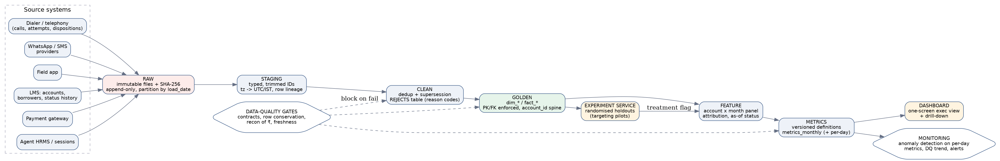

# Production analytics architecture

`Raw → Staging → Clean → Golden → Feature → Metrics → Dashboard`, with a DQ-gate service and an experiment service. This repository is a working, tested implementation of every layer (SQLite dialect; ANSI SQL except `datetime()` modifiers and `strftime`, see porting notes).

| Layer | Content | Key / grain | Rule |
|---|---|---|---|
| **Raw** | Source extracts exactly as received; `_load_id`, `_loaded_at`, SHA-256 per file | file + load_date | Append-only, immutable; never edited. Tested by hash manifest |
| **Staging** (`stg_*`) | Types, trimmed/upper IDs, timestamps → UTC + IST, `raw_row_id` lineage | 1 row in = 1 row out | No filtering |
| **Clean** (`clean_*`, `rejects`) | Dedup/supersession with reason codes | business PK | `raw = clean + rejects` asserted every run |
| **Golden** (`dim_*`, `fact_*`) | Conformed model, `account_id` spine, flags (`is_recovery`, `in_window`, `ref_collision_flag`) | PK per table | Only layer exposed to analysts |
| **Feature** (`ft_*`) | Account×month panel, payment attribution, as-of status | account×month | Rebuildable from golden |
| **Metrics** | `metrics_monthly` (+ daily in production), versioned definitions | month/day | Definitions in `docs/metric_definitions.md`; changing one bumps `metric_version` |
| **Dashboard** | One-screen exec view + drill-down | – | Reads metrics only |

## Data contracts (per source; enforced at Raw→Staging)
* **Schema:** column names/types/nullability, enumerations (`payment_status`, `call_status`, `disposition_code`+`version`, `timezone`), `schema_version` accepted set. Unknown enum or column → quarantine file, page owner, pipeline continues with last good partition.
* **Keys:** payments `payment_id`; calls `call_id`; dispositions `disposition_id`; attempts `attempt_id`; accounts `account_id`; agents `agent_id`; WhatsApp/SMS `event_id`; PTP `ptp_id`; visits `visit_id`.
* **Referential:** every event `account_id ∈ accounts` (blocking). `call_id`/`borrower_id` links monitored as *rates* (today ≈0% valid → warning until the source is fixed; contract requires ≥99%).
* **Semantics:** every timestamp column must declare its timezone; payments must carry `settled_at` and a status history (today status is a single value).
* **SLA:** freshness (payments ≤ 2h, calls ≤ 1h), completeness vs source row counts (±0.5%).

## Primary keys & lineage
PKs as above, enforced by unique indexes and tests. Lineage: every golden row carries `raw_row_id` (→ file, load id); `rejects(src_table, raw_row_id, reason)` records every removed row; metric tables record `metric_version`, `pipeline_run_id`, `as_of`. Column-level lineage is generated from the SQL (dbt-style `ref()` graph) and published in the data catalogue.

## Incremental processing, late-arriving data, backfills
* **Watermark by event time**, not load time. Each run reprocesses a trailing window: calls/dispositions **7 days** (observed re-ingests up to +120h), payments/status history **30 days** (settlement/reversal lag).
* **Idempotent upserts** (`MERGE` on PK): re-running a window yields identical output; dedup rules are deterministic (earliest timestamp, non-null agent, reference-preferred).
* **Late-arriving events** older than the window go to a `late_events` table and trigger a partition rebuild; the dashboard shows "restated" markers when a closed month changes by >0.5%.
* **Backfills:** parameterised by date range, run on a shadow schema, diffed against production via the reconciliation checks, then swapped atomically. Metric-definition changes require a full historical backfill + `metric_version` bump so MoM series stay comparable. Monthly snapshots of `metrics_monthly` with `as_of` preserve what leadership saw.

## Data-quality tests (blocking = stop publish; warning = alert)
| Test | Type |
|---|---|
| PK unique / not null on every golden table | blocking |
| FK `account_id` valid; `agent_id`, `vendor_id` valid | blocking |
| Row conservation raw = clean + rejects | blocking |
| ₹ reconciliation: raw SUCCESS − duplicate SUCCESS = golden SUCCESS; waterfall ties to the paisa | blocking |
| Independent recompute of 3 headline metrics from raw (pandas) = SQL | blocking (CI) |
| Rates within [0,100]; no month with NULL recovery | blocking |
| Duplicate-payment rate ≤ 4% (baseline 2.0%); NULL-reference rate; late-event share; unknown enum values | warning |
| Join-validity rates (call↔attempt account agreement, borrower_id agreement) | warning until source fixed |
| Dashboard figures = metrics tables (test compares `dashboard_data.json` to SQL) | blocking (CI) |

## Monitoring & anomaly detection
* **Pipeline health:** run duration, rows in/out per layer, rejects by reason (trend), freshness, schema drift.
* **Metric anomalies — always on a calendar-normalised basis:** daily net recovery per day compared with the same weekday over the trailing 8 weeks; robust z-score (median/MAD), alert at |z|>3 on two consecutive days; month-level changes shown **per observed day and in pp**, never raw month-on-month % (this is exactly the 11% error).
* **Change-point monitor:** the max-|t| permutation scan used in the notebook, run weekly on daily recovery, contact and PTP rates.
* **DQ-rate drift:** control charts on duplicate rate, NULL rates, share of calls outside business hours (today 54% → likely a timestamp contract defect), share of recovery landing on as-of closed accounts (today 23%).
* **Experiment guardrails:** sample-ratio-mismatch test on holdout assignment; pre-registered outcome; sequential-peeking prohibited before the planned duration.

## Porting notes (SQLite → warehouse)
`datetime(x,'-330 minutes')` → `x - INTERVAL '330 minutes'` (Postgres) / `TIMESTAMP_SUB` (BigQuery); `strftime('%w',x)` → `EXTRACT(DOW FROM x)`; `ROW_NUMBER() OVER` dedup, `LAG`, `CASE` are ANSI; `INSERT … SELECT` → `MERGE` for incremental loads; `COUNT(DISTINCT) OVER` (unsupported in SQLite) is supported natively. Orchestrate with Airflow/Dagster/dbt (one model per SQL file here).
